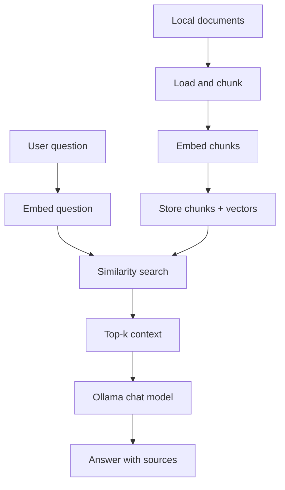

# Play_with_RAG_system

A progressive, framework-free Retrieval-Augmented Generation (RAG) engineering tutorial. Build RAG from scratch, one version at a time, with Ollama and plain Python.

## What you will build

A series of standalone Python projects (V01–V10), each an independently runnable tutorial chapter:

| Phase | Versions | Theme |
|---|---|---|
| 1. Understand RAG | V01–V03 | Naive RAG, ingestion and chunking, embeddings and retrieval |
| 2. Measure and improve quality | V04–V06 | Evaluation harness, hybrid search, advanced techniques |
| 3. Engineer the system | V07–V08 | Clean architecture, API, persistence, jobs |
| 4. Production readiness | V09–V10 | Security, observability, deployment, capstone |

**Recommended first public release: V01–V05.** That already tells a complete story (build, ingest, retrieve, measure, improve).

## Visual overview of the pipeline



## Prerequisites and local Ollama setup

1. **Python 3.10+** (standard library for early versions; typed packages later).
2. **Ollama** installed and running: https://ollama.com
3. Pull the models used by a version (see that version's README), for example:
   ```bash
   ollama pull embeddinggemma
   ollama pull gemma3:4b
   ```
4. Verify Ollama is reachable:
   ```bash
   curl http://localhost:11434/api/tags
   ```

## Version table

| Version | Project | Main learning objective | Status |
|---|---|---|---|
| V01 | Naive RAG | Understand the complete pipeline end to end | Implemented |
| V02 | Ingestion and chunking | Parse, clean, and chunk documents reliably | Planned |
| V03 | Retrieval engine | Embeddings, vector search, and persistence | Planned |
| V04 | Evaluation harness | Measure retrieval and answer quality, compare versions | Planned |
| V05 | Hybrid search | BM25, dense retrieval, RRF, metadata filters | Planned |
| V06 | Advanced RAG | Query rewriting, reranking, parent-child retrieval, abstention | Planned |
| V07 | Clean architecture | Testable, typed, modular Python package | Planned |
| V08 | API, persistence and jobs | FastAPI service, SQLite, streaming, ingestion jobs | Planned |
| V09 | Security and observability | Prompt injection, access control, logs, metrics, reliability | Planned |
| V10 | Deployment and capstone | Docker, CI/CD, load tests, final integrated application | Planned |

Update statuses only as versions are implemented, tested, and released (see `ROADMAP.md`).

## How to choose a version and run it

Each `vXX-*` folder is independent: it has its own dependencies, config, docs, tests, sample data, and run instructions. No runtime imports across versions.

1. Open the version folder (start with `v01-naive-rag` once it exists).
2. Read its `README.md` (a standalone tutorial chapter).
3. Follow "Installation and setup" and "Run the application".
4. Run the version's tests and quality checks.

## Shared conventions

- **No RAG framework** in core implementations (no LangChain, LlamaIndex, Haystack, …).
- **Free and local-first**: Ollama is the primary runtime for chat and embeddings.
- **CLI/JSON contract**: every version implements `docs/cli-contract.md`.
- **Measure, don't guess**: evaluation datasets and metrics exist from V02/V04.
- **Honest reporting**: never invent benchmark numbers or test results.
- Full conventions: `ROADMAP.md`, `AGENTS.md`, `CONTRIBUTING.md`.

## Model configuration and optional remote API

Ollama is the default. Remote OpenAI-compatible APIs are optional and introduced through provider interfaces (V07+). Never commit credentials; use environment variables.

## Benchmark datasets and diagrams

- Evaluation dataset schema: `docs/evaluation-dataset-schema.md`
- Diagrams are Mermaid (version-controlled text) in `docs/diagrams/`.
- Benchmark charts are generated from actual recorded results, never fabricated.

## Contribution guidelines, license, troubleshooting

- See `CONTRIBUTING.md` and `AGENTS.md` for how to contribute.
- Code is licensed under the `LICENSE` file (MIT).
- Sample documents are in `shared-resources/sample-documents/` with `LICENSE-NOTES.md`.

Acknowledgments: inspired by the desire to learn RAG by building it, without a framework.