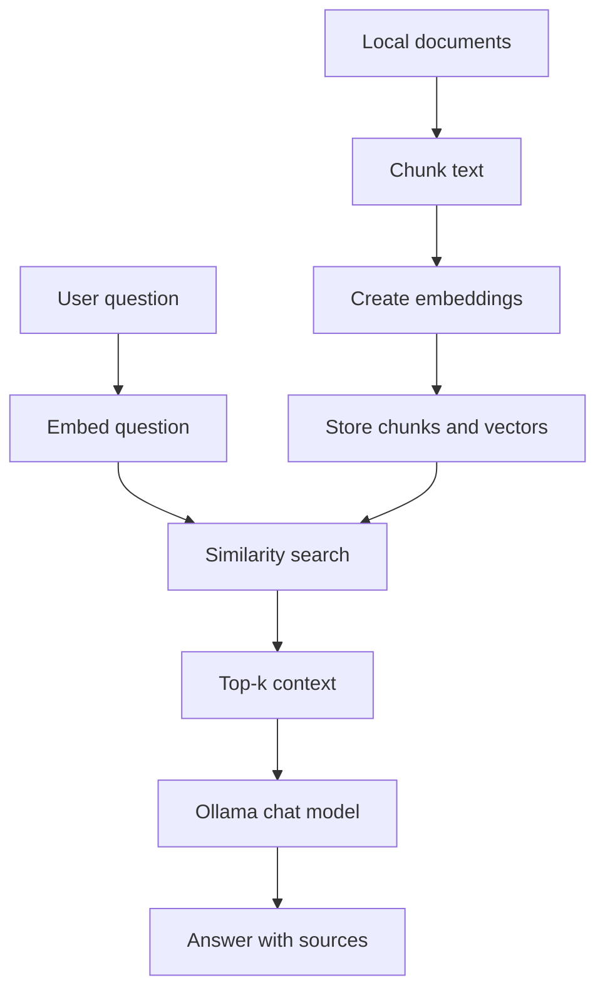

# Diagram conventions

Use Mermaid so diagrams are version-controlled text and render on GitHub. Keep `.mmd` sources in `docs/diagrams/` when diagrams grow large. Use consistent names: `architecture.mmd`, `retrieval-flow.mmd`, `deployment.mmd`.

Each version's diagram shows the components **actually implemented**, not a generic architecture.

## Recommended illustrations by phase
- V01–V03: chunking examples, vector similarity, embedding dimensions, retrieval rankings.
- V04–V06: keyword vs. dense retrieval, RRF, reranking, evaluation charts.
- V07–V08: package boundaries, dependency direction, API sequence diagrams, ingestion-job state diagram.
- V09–V10: trust boundaries, observability flow, deployment topology, failure-recovery diagrams.

## V01 example (`architecture.mmd`)

Benchmark charts must be generated from actual recorded results, never fabricated.