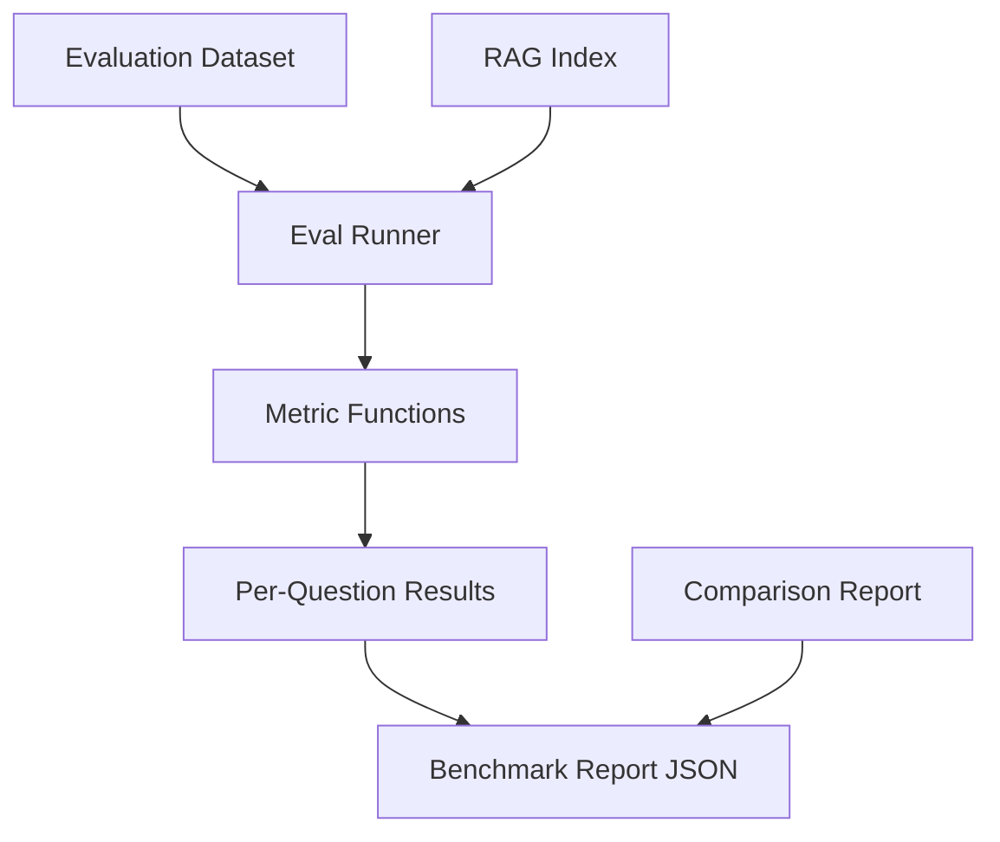

# V04 — Evaluation harness

Measure retrieval and answer quality, compare versions V01–V03 on a common
seed dataset. Provides one command to reproduce a benchmark report JSON.

## What you will learn

- How to load an index and an evaluation dataset and run retrieval for each
  question.
- How to compute precision@k, recall@k, mean reciprocal rank (MRR), and
  abstention rate using pure-Python metric functions.
- How versioned dataset files (`dataset_version` / `corpus_version`) ensure
  that results are comparable across runs.
- How to produce a single-command benchmark report and a side-by-side
  comparison of multiple indexes.

## Why this version exists

V03 proved the retrieval pipeline works, but there was no way to systematically
measure how good it is on a fixed set of questions, nor to compare different
versions (V01, V02, V03) on the same data. V04 adds an evaluation harness
so that every change can be quantified before it becomes permanent.

## Architecture diagram



## Installation and setup

```bash
cd v04-evaluation-harness
pip install -r requirements.txt
# Ensure Ollama is running with the models used by the indexes you want to evaluate:
#   ollama pull nomic-embed-text:latest
#   ollama pull qwen2.5-coder:7b
# Verify:
#   curl http://localhost:11434/api/tags
```

## Run the application

```bash
# Evaluate a single index against the seed dataset
python rag.py eval --index ./index.json --dataset ./tests/fixtures/eval-dataset.json --top-k 5 --json

# Compare multiple indexes (e.g. V01 vs V02 vs V03)
python rag.py compare --indexes ./v01-naive-rag/index.json ./v02-ingestion-and-chunking/index.json ./v03-retrieval-engine/index.json --top-k 5 --json
```

## Evaluation runner detailed

The `run_eval` function in `rag.py` loads a V03-format index and a
question‑answer dataset, runs top‑k retrieval for each question, and computes:

- **precision@k** – fraction of the top‑k retrieved chunks that are relevant
- **recall@k** – fraction of all relevant chunks found in the top‑k
- **MRR** – mean reciprocal rank of the first relevant chunk
- **abstention rate** – fraction of questions where no relevant chunk was found

Metric functions are pure-Python and can be tested without a running Ollama
instance.

## Benchmark report output (JSON example)

```json
{
  "dataset_version": "1.0.0",
  "corpus_version": "1.0.0",
  "top_k": 5,
  "total_questions": 24,
  "average_precision_at_k": 0.42,
  "average_recall_at_k": 0.35,
  "average_mrr": 0.31,
  "abstention_rate": 0.12,
  "per_question": [
    {
      "question_id": "q001",
      "question": "What is RAG?",
      "type": "factual",
      "answerable": true,
      "relevant_chunk_positions": [0, 2],
      "precision_at_k": 0.5,
      "recall_at_k": 0.5,
      "mrr": 1.0,
      "abstained": false,
      "difficulty": "easy"
    },
    ...
  ]
}
```

## Comparison report output (JSON example)

```json
[
  {
    "index_path": "./v01-naive-rag/index.json",
    "average_precision_at_k": 0.28,
    "average_recall_at_k": 0.22,
    "average_mrr": 0.19,
    "abstention_rate": 0.21
  },
  {
    "index_path": "./v02-ingestion-and-chunking/index.json",
    "average_precision_at_k": 0.35,
    "average_recall_at_k": 0.29,
    "average_mrr": 0.26,
    "abstention_rate": 0.15
  },
  {
    "index_path": "./v03-retrieval-engine/index.json",
    "average_precision_at_k": 0.42,
    "average_recall_at_k": 0.35,
    "average_mrr": 0.31,
    "abstention_rate": 0.12
  }
```